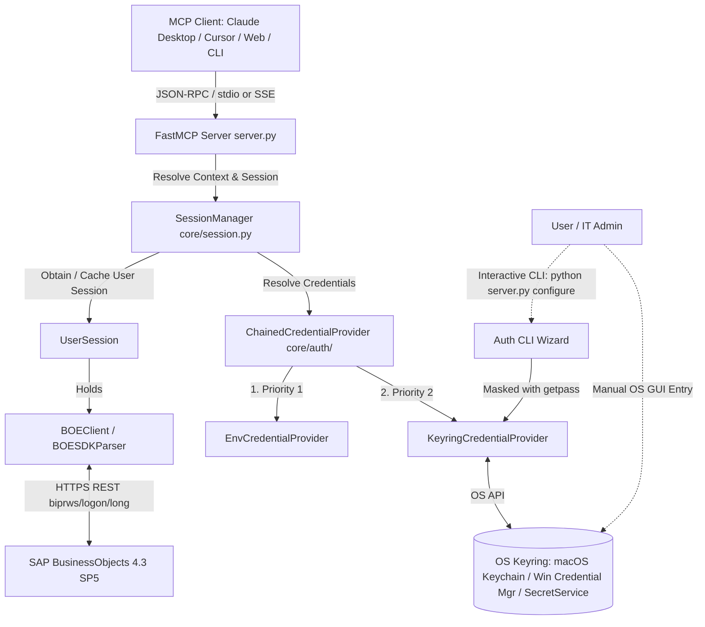

# Architecture & Design: Enterprise Authentication & Isolated Sessions for SAP BO MCP

**Document Version:** 1.0.0  
**Target Release:** 0.3.0  
**Author:** Antigravity AI & Ballarin, Alessio  
**Status:** Approved  
**Date:** October 2026  

---

## 1. Executive Summary & Purpose

The SAP BusinessObjects Model Context Protocol (MCP) server provides AI agents and enterprise desktop/web clients with direct, automated interactions against the SAP BusinessObjects BI Platform 4.3 SP5 REST Web Services (`biprws`).

Initially developed with hardcoded credentials in a local `.env` file, enterprise adoption demands:
1. **Interactive, non-plaintext credential intake** to prevent leaking sensitive passwords in source code, configuration files, terminal history, or LLM chat logs.
2. **OS-native secure credential storage** (macOS Keychain, Windows Credential Manager, Linux SecretService) via the standard Python `keyring` library, with support for manual configuration by users or IT administrators.
3. **Session isolation for multi-tenant and centralized deployments**, ensuring that SAP BusinessObjects user rights, row-level universe data security profiles, and folder permissions are strictly preserved on a per-user basis without cross-contamination.
4. **Graceful degradation and startup resilience**, avoiding broken stdio streams or abrupt crashes when credentials are not yet configured.

---

## 2. Understanding Summary & Scope

- **What is being built:** A multi-tier authentication resolution system and session-isolated execution framework for the SAP BusinessObjects MCP server.
- **Why it exists:** To eliminate plaintext credentials in enterprise environments while strictly honoring SAP BO's native security and authorization models.
- **Who it is for:** Enterprise BI analysts, data engineers, administrators, and autonomous agents interfacing through MCP clients (e.g., Claude Desktop, Cursor, CLI agents, centralized MCP web gateways).
- **Explicit Non-Goals:**
  - Creating a single shared/technical superuser account to execute all tool operations (this violates SAP BO's user-specific rights and auditability).
  - Attempting interactive `input()` or `getpass()` prompts over `sys.stdin` during stdio-based MCP execution (which fatally corrupts JSON-RPC framing).
  - Implementing custom OAuth2 / SAML identity brokers from scratch (we bind directly to SAP BO's `biprws/logon/long` REST endpoint).

---

## 3. Assumptions & Non-Functional Requirements

| Category | Requirement | Specification |
| :--- | :--- | :--- |
| **Security** | Zero Plaintext Passwords | Passwords must use `pydantic.SecretStr` in memory to prevent accidental exposure via logging or `repr()`. Stored persistently only in OS Keyring. |
| **Session Isolation** | Multi-User Integrity | Every client connection retains its own `BOEClient` and `BOESDKParser` instance with a dedicated `X-SAP-LogonToken`. |
| **Startup Resilience** | Stdio Channel Safety | If credentials are absent, the server starts normally and provides structured, actionable setup instructions in tool responses rather than crashing. |
| **Performance** | Low Latency Keyring & Token Cache | Keyring resolution occurs on-demand upon first logon (<50ms). Active SAP session tokens are cached in-memory with automatic silent re-authentication on 401s. |
| **Compatibility** | Cross-Platform Support | Supported on macOS (Keychain), Windows (Credential Manager), and Linux (SecretService / D-Bus), with graceful warning on headless/container environments. |

---

## 4. Decision Log

| ID | Decision | Considered Alternatives | Rationale & Trade-offs |
| :--- | :--- | :--- | :--- |
| **DEC-01** | **Masked CLI Setup + Keyring Storage** | 1. Prompt inside LLM chat<br>2. OS GUI popup dialogs<br>3. Plaintext `.env` only | Passwords entered in LLM chat are logged in model transcripts. GUI popups can freeze headless servers. An interactive CLI wizard (`getpass.getpass()`) writing to OS Keyring ensures zero plaintext leakage and maximum enterprise compliance. |
| **DEC-02** | **Manual OS Credential Entry Support** | Proprietary encrypted file format | Using standard `keyring` allows end-users and IT departments to manage passwords via native OS tools (macOS Keychain Access, Windows Credential Manager) without running Python scripts. |
| **DEC-03** | **Hierarchical Chained Credential Resolution** | Hard requirement on single source | Priority: `1. Environment / .env` (convenient for local dev/testing) $\rightarrow$ `2. OS Keyring` (default for users/enterprise) $\rightarrow$ `3. Informative setup guide`. |
| **DEC-04** | **Per-Session Parser Isolation (`SessionManager`)** | Global singleton `parser` | A global parser causes user credential leakage and race conditions in concurrent/centralized deployments. `SessionManager` guarantees 1:1 binding between client sessions and SAP BO user rights. |
| **DEC-05** | **Graceful Missing Credential Handling** | Process termination with `sys.exit()` | MCP clients like Claude Desktop surface `sys.exit(1)` as opaque "Connection closed" errors. Returning markdown guidance directly from tools enables smooth user self-service. |

---

## 5. Architectural Components



### 5.1. Module Structure

```text
BO_MCP/
├── core/
│   ├── auth/
│   │   ├── __init__.py          # Public exports (get_credentials, configure_cli)
│   │   ├── models.py            # AuthCredentials (SecretStr, username, api_url)
│   │   ├── providers.py         # CredentialProvider, EnvProvider, KeyringProvider, ChainedProvider
│   │   └── cli.py               # Interactive setup CLI (configure, test, clear)
│   ├── session.py               # SessionManager and UserSession classes
│   ├── client.py                # BOEClient with silent token refresh support
│   └── exceptions.py
├── server.py                    # FastMCP tool registrations with SessionManager integration
└── tests/
    ├── test_auth_providers.py   # Unit tests for Env, Keyring, and Chained providers
    └── test_session_manager.py  # Unit tests for session isolation and token caching
```

### 5.2. Component Responsibilities

1. **`core.auth.models.AuthCredentials`**:
   - Encapsulates `username: str`, `password: SecretStr`, and `api_url: Optional[str]`.
   - Prevents plaintext password exposure in exceptions, logging, or debugging strings.

2. **`core.auth.providers.KeyringCredentialProvider`**:
   - Communicates with OS Keyring under service name `sap-business-objects-mcp`.
   - Handles headless environments safely: if no keyring backend is available, gracefully logs a warning and yields `None`.

3. **`core.auth.cli`**:
   - Invoked via `python server.py configure` or `python -m core.auth configure`.
   - Prompts for `API URL`, `Username`, and `Password` (masked via `getpass`).
   - Offers an option to immediately test connectivity against SAP BO before committing to storage.

4. **`core.session.SessionManager`**:
   - Manages dictionary of `session_id -> UserSession`.
   - In stdio mode, binds to a default session ID (`"local-default"`).
   - In HTTP/SSE mode, extracts session/client ID from request context.
   - Instantiates a clean, independent `BOESDKParser` with dedicated headers and cookies.

---

## 6. Manual OS Keyring Configuration Guide

For users who prefer not to execute the Python CLI wizard, credentials can be created directly within the host operating system:

### 6.1. macOS (Keychain Access)
1. Open **Keychain Access** (`/Applications/Utilities/Keychain Access.app`).
2. Click the **Create New** icon (+), select **New Password Item...**.
3. Fill in:
   - **Keychain Item Name / Service:** `sap-business-objects-mcp`
   - **Account Name:** Your SAP BO username (e.g., `alessio.ballarin`)
   - **Password:** Your SAP BO password
4. Click **Add**.

### 6.2. Windows (Credential Manager)
1. Open **Control Panel** $\rightarrow$ **Credential Manager** (or run `control /name Microsoft.CredentialManager`).
2. Select **Windows Credentials** $\rightarrow$ click **Add a generic credential**.
3. Fill in:
   - **Internet or network address:** `sap-business-objects-mcp`
   - **User name:** Your SAP BO username
   - **Password:** Your SAP BO password
4. Click **OK**.

### 6.3. Linux (SecretService / Seahorse)
- In desktop environments, open **Passwords and Keys** (Seahorse) and add a password under default keyring with service `sap-business-objects-mcp`.
- Or via terminal:
  ```bash
  secret-tool store --label="SAP BO MCP" service sap-business-objects-mcp username <your-username>
  ```

---

## 7. Error Handling & Edge Cases

| Scenario | Behavior |
| :--- | :--- |
| **No credentials configured anywhere** | Tool call returns: *"No SAP BusinessObjects credentials found. Run `python server.py configure` in your terminal or configure `.env` / OS Keyring."* Stdio process remains alive. |
| **Headless Linux / CI/CD without D-Bus** | Keyring logs diagnostic notice; falls back to environment variables without crashing. |
| **SAP Logon Token Expired (HTTP 401)** | `BOEClient` intercepts 401, attempts a transparent re-logon using cached `AuthCredentials`, and retries the original request once. |
| **Invalid Credentials in Keyring** | Returns clear login failure: *"Authentication failed for user '...'. Please verify your password using `python server.py configure`."* |

---

## 8. Testing Strategy

1. **Unit Testing (`pytest`)**:
   - Mock `keyring` via `keyring.backend.KeyringBackend` fixture to test read/write without modifying real user keychains.
   - Test `ChainedCredentialProvider` precedence (`.env` overrides Keyring; Keyring is used when `.env` is empty).
   - Test `SecretStr` masking: ensure `repr(credentials)` shows `**********`.
   - Test `SessionManager` concurrency: verify multiple session IDs create distinct `BOEClient` instances with separate cookies and tokens.
2. **CLI Testing**:
   - Mock `input()` and `getpass.getpass()` using `monkeypatch` to verify automated CLI setup flow.
3. **Integration Verification**:
   - Test live or mock SAP BO logon endpoint with valid/invalid credentials.
