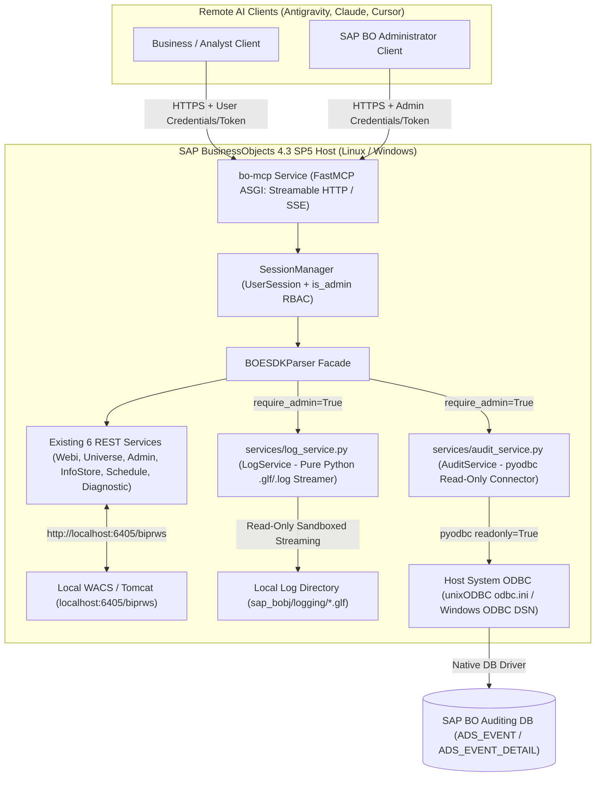

# Co-Located Remote MCP Server, Local Log Analyzer & ODBC Auditing Architecture

This specification documents the validated design for evolving `bo-mcp` from a local `STDIO` server into a **co-located, multi-tenant remote MCP server** (`Streamable HTTP` / `SSE`) running natively as a system service directly on the **SAP BusinessObjects BI Platform 4.3 SP5** host (**Linux** and **Windows Server**).

---

## 1. Understanding Summary

- **What is being built:** Evolution of `bo-mcp` into a remote network MCP server (`Streamable HTTP` / `SSE`) executed natively on the SAP BusinessObjects machine and extended with two co-located diagnostic domains:
  1. **`LogService` (`services/log_service.py`):** Streaming inspection of local SAP BusinessObjects server trace logs (`.glf`, `.log`, `.trc`) inside the installation `logging/` directory.
  2. **`AuditService` (`services/audit_service.py`):** Direct, read-only introspection of the SAP BusinessObjects Auditing Database (`ADS_*` tables) via the host's native `ODBC` configuration (`pyodbc`).
- **Why it exists:** Co-locating the MCP server on the SAP BO host eliminates HTTP latency to `biprws`/`raylight` (`localhost:6405`) and unlocks deep Root Cause Analysis (RCA) by correlating CMS schedule metadata (`SI_SCHEDULE_STATUS = 3`), OS-level server trace logs (`.glf`), and historical `ADS_EVENT` telemetry.
- **Who it is for:**
  - **Enterprise Business Users & BI Analysts (Multi-Tenant):** Connect remotely using their own SAP BO identity (`UserSession` isolated in `SessionManager`), strictly enforcing individual SAP BO permissions and row-level security.
  - **SAP BusinessObjects Administrators:** In addition to standard REST tools, administrators are exclusively authorized (via session RBAC verification) to invoke local log inspection and Auditing DB tools.
- **Key Constraints:**
  - **Native Cross-Platform Execution (No Docker Required):** Runs as a native OS service (`systemd` on Linux + `unixODBC`; `Windows Service` on Windows + Windows ODBC Data Source Administrator) managed via `uv`, reusing existing host ODBC drivers/DSNs and local filesystem paths.
  - **Hybrid Read-Only Guardrails:** Combines high-level pre-built diagnostic tools with filtered log search and a strictly Read-Only SQL query tool (`SELECT`/`WITH` only) on the Auditing DB.
- **Explicit Non-Goals:**
  - No dependency on Docker Engine on production SAP BusinessObjects nodes.
  - No write/mutating operations (`INSERT`, `UPDATE`, `DELETE`, `DDL`) against the Auditing Database and no modification/deletion of SAP BO log files.
  - No shared superuser fallback token across multi-tenant remote sessions.

---

## 2. Non-Functional Assumptions

1. **Host Resource Protection:** Because `bo-mcp` shares hardware with SAP BusinessObjects core processes (`CMS`, `WebiProcessingServer`, `AdaptiveJobServer`), `.glf` log files are read via reverse-chunked streaming (64 KB blocks, never loading multi-hundred-MB files into RAM), and ODBC queries enforce strict execution timeouts (`15–30s`) and row caps (`cursor.fetchmany(max_rows)`).
2. **Scale & Concurrency:** Supports 5–50 concurrent sessions in [`SessionManager`](../../core/session.py) with an automated background task invoking `cleanup_expired_sessions()` every 5 minutes to call `bo_logoff()` and release concurrent SAP BO licenses.
3. **Security & Privacy:**
   - **RBAC Enforcement:** Admin status is verified upon session authentication by checking membership in the SAP BO `Administrators` group (or configurable `SAP_BO_ADMIN_GROUPS`) via [`AdminService`](../../services/admin_service.py) and cached as `session.is_admin`.
   - **Filesystem Sandboxing:** All log operations resolve paths against `SAP_BO_LOG_DIR` using `Path.resolve().is_relative_to(base_dir)` to prevent path traversal (`../`).
   - **Transport Security:** Network exposure over HTTPS (via local reverse proxy or TLS certificates).
4. **Reliability & Graceful Degradation:** If `SAP_BO_LOG_DIR` or `SAP_BO_AUDIT_DSN` are unconfigured or unreachable, the server starts normally and all 48 REST API tools remain operational while Log/Audit tools return actionable configuration guidance.
5. **Maintainability:** Single Python 3.13+ codebase managed with `uv`, retaining `stdio` compatibility for local developer testing while supporting `--transport streamable-http|sse` for server deployment.

---

## 3. Architectural Decision Log

| ID | Decision | Alternatives Considered | Rationale |
| :--- | :--- | :--- | :--- |
| **D1** | **Multi-Tenant Access with Session RBAC** (`is_admin` gate on Log & Audit tools) | Single-admin global credentials; unrestricted tool access for all logged-in users | Preserves SAP BO user security profiles while protecting local OS log files and the Auditing DB, which bypass `biprws` security. |
| **D2** | **Native OS System Service** (`systemd` on Linux, `Windows Service` on Windows via `uv`) | Docker-only deployment; Hybrid Docker + Native | Avoids installing Docker on production SAP BO servers, directly reuses the host's pre-configured Auditing ODBC DSN (`odbc.ini` / Windows ODBC), and guarantees Linux/Windows portability. |
| **D3** | **Hybrid Read-Only Diagnostic Surface** (structured tools + `SELECT`-only SQL validator) | Pre-packaged tools only (no custom SQL); unrestricted SQL/file access | Gives administrators full investigative flexibility while guaranteeing zero mutation risk on the Auditing DB or log directory. |
| **D4** | **In-Process Modular Monolith** (`FastMCP ASGI` + `pyodbc` `fetchmany` + pure-Python `.glf` parser) | `SQLAlchemy` ORM + OS shell commands (`grep`/`Select-String`); Dual separate MCP servers | Keeps memory footprint minimal (~60–100 MB), eliminates OS-specific shell branching, works identically across Oracle/SQL Server/HANA/Postgres, and allows in-memory correlation with [`DiagnosticService`](../../services/diagnostic_service.py). |

---

## 4. Validated System Design

### 4.1 High-Level Topology

### 4.2 Remote Transport, Session Resolution & RBAC (`server.py` & `core/session.py`)

1. **Transport Startup CLI & Environment Variables:**
   - Extend [`server.py`](../../server.py) to accept `--transport stdio|sse|streamable-http` (`MCP_TRANSPORT`), `--host` (`MCP_HOST`), and `--port` (`MCP_PORT`).
   - Default `SAP_BO_REST_API_URL` to `http://localhost:6405/biprws` when co-located on the SAP BO host.
2. **Dynamic Context Session Binding (`@with_session`):**
   - Replace the static `default_session` binding in tool handlers with a `@with_session(require_admin: bool = False)` decorator that inspects FastMCP `ctx.session_id` and resolves the isolated [`UserSession`](../../core/session.py) from [`SessionManager`](../../core/session.py).
   - When running in remote network mode (`sse` or `streamable-http`), automatic fallback to `.env` or OS Keyring credentials for unauthenticated sessions is **disabled** so every remote client must authenticate explicitly via `login` or HTTP headers (`X-SAP-LogonToken`).
3. **RBAC Verification & Session Cleanup:**
   - Upon authentication, `UserSession` queries [`AdminService`](../../services/admin_service.py) to determine whether the authenticated user belongs to `Administrators` (or `SAP_BO_ADMIN_GROUPS`) and stores `session.is_admin: bool`.
   - Tools decorated with `@with_session(require_admin=True)` raise `BOEPermissionError` if `not session.is_admin`.
   - A periodic background task invokes `session_manager.cleanup_expired_sessions()` every 5 minutes.

### 4.3 Local SAP BO Log Analyzer (`services/log_service.py`)

1. **Path Sandboxing & Multi-OS Compatibility:**
   - Configured via `SAP_BO_LOG_DIR` (e.g., `/sap_bobj/logging` on Linux or `C:\Program Files (x86)\SAP BusinessObjects\SAP BusinessObjects Enterprise XI 4.0\logging` on Windows).
   - Every file access validates `target_path.resolve().is_relative_to(base_log_dir)`.
2. **Reverse-Chunked `.glf` & `.log` Streaming:**
   - Reads SAP BusinessObjects `.glf` (Generic Log Format, pipe-delimited `|`) and `.log`/`.trc` files in 64 KB chunks from the end of the file (*reverse tailing*) using `encoding="utf-8", errors="replace"` and shared read access so active log files written by `WebiProcessingServer` or `AdaptiveJobServer` are never locked or loaded entirely into memory.
   - Extracts structured fields (`timestamp`, `severity`, `server_name`, `thread_id`, `message`).
3. **Admin-Only MCP Tools:**
   - `list_bo_logs(server_type: Optional[str] = None, hours_back: int = 24)`
   - `search_bo_logs(pattern: str, server_type: Optional[str] = None, hours_back: int = 12, severity: Optional[str] = None, max_matches: int = 50)`
   - `get_bo_log_context(file_name: str, line_number: int, context_lines: int = 20)`

### 4.4 Direct Auditing Database Connector (`services/audit_service.py`)

1. **Native Host ODBC Connection (`pyodbc`):**
   - Configured via `SAP_BO_AUDIT_DSN` (or `SAP_BO_AUDIT_CONNECTION_STRING`), `SAP_BO_AUDIT_USER`, and `SAP_BO_AUDIT_PASSWORD` (`SecretStr`).
   - Connects with `pyodbc.connect(..., readonly=True, timeout=20)`, leveraging the system DSN already configured on the SAP BO server for the CMS Auditing engine (`odbc.ini` on Linux / Windows ODBC Administrator).
2. **RDBMS-Agnostic ANSI SQL & Row Capping:**
   - Queries the standard SAP BO 4.3 `ADS_*` schema (`ADS_EVENT`, `ADS_EVENT_DETAIL`, `ADS_EVENT_TYPE_STR`, `ADS_STATUS_STR`) using portable ANSI SQL and enforces row limits in Python via `cursor.fetchmany(max_rows)` so queries execute identically on Oracle, Microsoft SQL Server, SAP HANA, PostgreSQL, and SQL Anywhere.
3. **Admin-Only MCP Tools:**
   - `get_audit_failed_events(hours_back: int = 24, event_type: Optional[str] = None, max_rows: int = 100)`
   - `get_audit_heavy_reports(days_back: int = 7, top_n: int = 20)`
   - `get_audit_user_activity(username: Optional[str] = None, hours_back: int = 24, max_rows: int = 100)`
   - `query_audit_db(sql_query: str, max_rows: int = 200)` — Enforces a strict Read-Only SQL validator (strips SQL comments, rejects multi-statement `;` chains, and requires a single `SELECT` or `WITH` query).

### 4.5 Triple Diagnostic Correlation (`services/diagnostic_service.py`)

- [`DiagnosticService`](../../services/diagnostic_service.py) can optionally enrich each failed batch cluster (`SI_SCHEDULE_STATUS = 3`) returned by `diagnose_batch_failures` with:
  1. Matching `.glf` error trace snippets from `LogService` within the instance failure timestamp window.
  2. Execution duration and event details from `AuditService` (`ADS_EVENT`).

### 4.6 Error Handling, Edge Cases, Deployment & Testing

1. **Typed Exceptions ([`core/exceptions.py`](../../core/exceptions.py)):**
   - Add `BOEPermissionError`, `BOELogError`, and `BOEAuditDBError`.
2. **Linux & Windows Operational Edge Cases:**
   - **Linux ODBC Environment:** The `systemd` unit (`deploy/bo-mcp.service`) runs under the non-root SAP BO OS account (e.g., `bobj`) and loads `ODBCINI` and `LD_LIBRARY_PATH` from the SAP BO environment so `pyodbc` resolves native drivers seamlessly.
   - **Windows Concurrent File Locks:** `LogService` opens `.glf` files in shared read mode (`errors="replace"`) and discards any incomplete trailing line being actively flushed by a SAP BO server process.
   - **Windows Service Wrapper:** Provided via `NSSM` or `sc.exe` configuration launching `uv run python server.py --transport streamable-http`.
3. **Unit Testing Strategy (`tests/`):**
   - Synthetic `.glf` fixtures in `tmp_path` verifying reverse streaming, path traversal rejection, and truncated UTF-8 handling.
   - Mocked `pyodbc` unit tests covering `AuditService` diagnostic queries and the `SELECT`-only SQL validator (rejecting `; DROP`, `UPDATE`, `DELETE`, and comment-obfuscated mutations).
   - RBAC unit tests verifying `BOEPermissionError` when `session.is_admin is False`.
