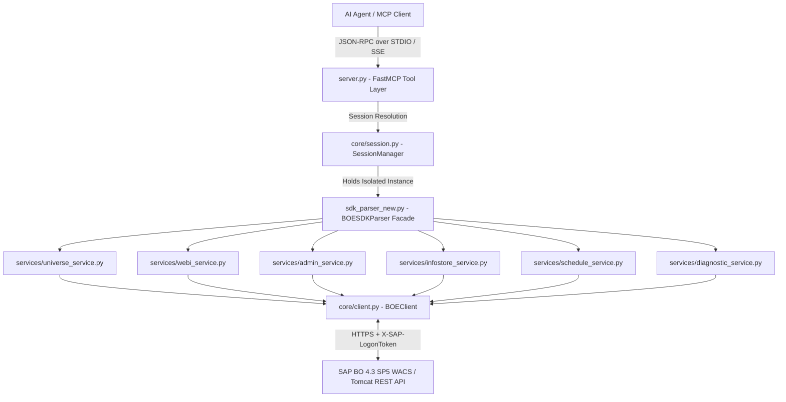

# System Overview & Layered Design

The **SAP BusinessObjects MCP Server (`bo-mcp`)** exposes the capabilities of **SAP BusinessObjects BI Platform 4.3 SP5** RESTful Web Services (`biprws`, `raylight/v1`, `sl/v1`) as structured Model Context Protocol (MCP) tools via `FastMCP`.

---

## 1. Layered Architecture

---

## 2. Core Modules & Responsibilities

### 2.1 FastMCP Surface (`server.py`)
- Registers **40+ MCP tools** organized into 8 functional domains.
- Provides a built-in CLI dispatcher (`python server.py configure | status | test | clear`) that delegates interactive credential management to `core.auth.cli` before starting the MCP transport loop.
- Enforces clean exception handling and structured dictionary/Pydantic JSON responses.

### 2.2 Session & Client Core (`core/`)
- **[`core/client.py`](../../core/client.py) (`BOEClient`)**:
  - Low-level HTTP wrapper around `requests.Session`.
  - Automatically computes endpoint prefixes:
    - Base BIP API: `{base_url}` (e.g., `http://host:6405/biprws`)
    - Web Intelligence (Raylight): `{base_url}/raylight/v1`
    - Semantic Layer: `{base_url}/sl/v1`
    - CMS Query & Platform v1: `{base_url}/v1`
  - Injects `X-SAP-LogonToken` into request headers.
  - Crucial safeguard: strips stale `X-SAP-LogonToken` headers when fetching fresh authentication templates from `GET /biprws/logon/long`.
  - Automatically detects binary content types (`application/pdf`, `application/vnd.openxmlformats-officedocument...`, `application/octet-stream`) or honours `raw_bytes=True` for file exports.
- **[`core/session.py`](../../core/session.py) (`SessionManager` & `UserSession`)**:
  - Maintains isolated `UserSession` containers indexed by `session_id`, preventing cross-user token contamination. See [Enterprise Authentication & Session Isolation](./authentication_and_sessions.md).
- **[`core/exceptions.py`](../../core/exceptions.py)**:
  - Domain exception hierarchy: `BOEError` (base), `BOEAuthError` (HTTP 401 / logon failures), `BOENotFoundError` (HTTP 404), and `BOEProcessingError` (`WSR 00999` Webi engine exceptions).
- **[`core/models.py`](../../core/models.py)**:
  - Strict Pydantic v2 data contracts (`FailureCategory`, `PotentialCause`, `ClusterDiagnosis`, `BatchDiagnosticsReport`).

### 2.3 Domain Service Layer (`services/`)
Each service encapsulates a single bounded context of the SAP BO REST API:
1. **[`services/universe_service.py`](../../services/universe_service.py) (`UniverseService`)**:
   - Queries `CI_APPOBJECTS` and `/sl/v1/universes` for UNX/UNV metadata, business layer object hierarchies, relational connection IDs, and report lineage.
2. **[`services/webi_service.py`](../../services/webi_service.py) (`WebiService`)**:
   - Interfaces with `/raylight/v1/documents` for Webi document lifecycle, parameters/LOVs, Data Provider SQL extraction, Change Data Source repointing (`mappings`), tabular block dataset extraction (`/dataset` with fallback to `/data`), variables, comments, and multi-format binary exports (`PDF`, `XLSX`, `CSV`).
3. **[`services/admin_service.py`](../../services/admin_service.py) (`AdminService`)**:
   - Executes arbitrary CMS queries (`POST /biprws/v1/cmsquery`), audits users and groups, toggles account status, and monitors/terminates active enterprise sessions.
4. **[`services/infostore_service.py`](../../services/infostore_service.py) (`InfoStoreService`)**:
   - Navigates and manages public folders, recursive subfolder trees, folder documents, and corporate categories.
5. **[`services/schedule_service.py`](../../services/schedule_service.py) (`ScheduleService`)**:
   - Inspects recurring report schedules and historical execution instances (`SI_SCHEDULE_STATUS`).
6. **[`services/diagnostic_service.py`](../../services/diagnostic_service.py) (`DiagnosticService`)**:
   - Implements the [Intelligent Diagnostics Engine](./intelligent_diagnostics_engine.md) for automated nocturnal batch failure triage.

### 2.4 Unified Facade (`sdk_parser_new.py`)
- `BOESDKParser` instantiates `BOEClient` and all six domain services, providing a backwards-compatible unified interface consumed by `SessionManager` and `server.py`.
